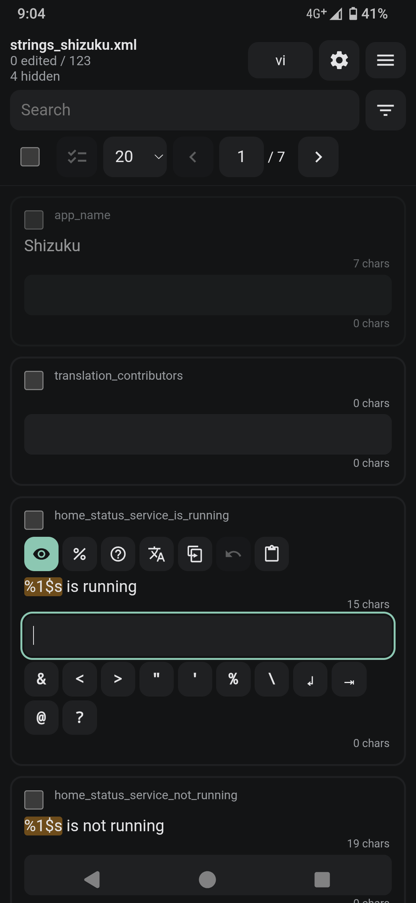

# Android Localization

A mobile-first localization app that fits right in your pocket. Open a file, translate, run QA checks and save it, all from your phone.

  
  
  

## Features

### Formats
- **Two formats:** Android `strings.xml` (strings, string arrays and plurals) and XLIFF 1.2 (`.xlf`, `.xliff`). XLIFF 2.x is not supported.
- **Lossless saving:** `strings.xml` is saved from your original file with only the translated texts replaced, so comments, order, spacing, `xmlns` declarations and untranslated entries stay untouched.
- **Save XLIFF as `strings.xml`:** convert an XLIFF 1.2 file exported from Android resources straight to an Android `strings.xml`.
- **Import translations:** bring translations from another `strings.xml` or XLIFF 1.2 file, match them by key or ID (segments included), review them in an import preview, then fill only empty units or apply all. Quote escaping is converted between the two formats automatically.
- **XML error report:** if a file is not valid XML, see the errors and save the report as `.txt`.
- **XLIFF details:** `<group>` inheritance (`translate`, `restype`, `maxwidth`, `maxbytes`, `size-unit`), multi-segment units (`<mrk mtype="seg">`), approval (`approved="yes"`), `<context-group>`, `<note>` with its attributes and `<alt-trans>` proposals.
- **`strings.xml` details:** `translatable="false"`, `formatted="false"` (toggle per unit), `product` variants and comments inherited by the following strings.

### Editing
- **Built for the phone:** a compact, touch-friendly editor that works one-handed, with a Crowdin-style list view and pagination (10, 20, 50, 100 or all units per page, jump to page).
- **Special character bar:** insert `&`, `<`, `>`, quotes, `%%`, `\\`, `\n`, `\t`, `@` and `?` in the correct escaped form for the current format (and unescaped inside CDATA).
- **Character counter:** the target text is counted against its own `maxwidth` / `maxbytes` limit and turns red when over.
- **Show whitespace:** spaces shown as `•` and line breaks as `¬` without changing the text.
- **Auto indent:** a new line keeps the leading spaces or tabs of the previous one.
- **Approve and hide:** approve XLIFF units, and hide or unhide units (`translate="no"` in XLIFF, `translatable="false"` in `strings.xml`). Hidden units can be exported as `translatable="false"` or left out.
- **Undo changes:** revert edited units to the text they had when the file was opened.

### QA checks
- **Placeholders and tags, spaces and line breaks, double spaces, end punctuation, numbers, valid XML, glossary terms, unescaped quotes, backslashes and `%` in `strings.xml`, and max length.**
- **Configurable:** turn each check on or off, and choose whether to also check hidden and approved units.

### Glossary
- **Your own terminology:** get warnings when a translation ignores it.
- **Import CSV, TSV or TBX:** choose the delimiter, header row, and source and target columns before importing.

### Similar translations
- **Find earlier translations of similar source text** in the same file, with four algorithms (Levenshtein by characters or words, Dice, Jaccard), a minimum match percentage, and comparison by source or target.
- **Alt-trans tab:** see the `<alt-trans>` proposals (TM / MT matches) stored in an XLIFF unit.

### Machine translation
- **Providers:** Google (free, with MyMemory), Gemini, Groq and OpenRouter. Bring your own API keys for the AI providers; keys stay on the device.
- **Context-aware AI:** choose what is sent with each text: key name, comments or XLIFF context, group purpose and `restype`, notes, and length limits and validation rules. Add your own notes for the AI (tone, app type, terms to keep).
- **Several suggestions:** ask the AI for up to 6 alternatives and pick one.
- **Faster bulk translation:** merge several units into one request (2 to 30), with automatic retry of any unit that comes back incomplete.
- **Rate limit and model list:** set requests per minute, load the available models from the server, and test the connection.

### Search, filters and sorting
- **Search** keys, IDs, source, context, notes and translation text, each scope switchable, with optional regex and filters for string arrays and plurals.
- **14 sort orders:** edited, QA issues, clipboard, unapproved, hidden, untranslated, same as source, longest or shortest source or target, over max length and `formatted="false"`.
- **Marks:** units affected by a bulk action are highlighted until you clear the marks.

### Bulk actions
- **Machine translate, approve or unapprove, hide or unhide, copy source, undo, save to or clear the clipboard** on many units at once.
- **Smart selection:** select all shown, and deselect hidden, translated or approved units from the selection.
- **Safe by default:** actions that change group-level attributes (such as `translate` or `approved`) warn you before they are applied.

### Per-unit clipboard
- **Keep alternative translations** next to a unit and swap them in when needed.

### Languages
- **Target language picker** with search, plus custom languages by code and optional name.

### Session and appearance
- **Session restore:** your edits, approvals, clipboards, filters, sort order and page are kept on the device and can be restored on the next launch.
- **Themes:** light, dark or follow the system, with 8 accent colors.

### Save and share
- **Export to the Documents folder** or through the Android share sheet.

## License

Licensed under the [GNU Affero General Public License v3.0](LICENSE.md) (AGPL-3.0).

## FAQ

### 1. Why did you discontinue the React version? And what is your UI philosophy?

Testing a React app without access to a PC turned out to be a major headache. Because there is no desktop build, the user interface is tailored specifically for Android and likely wouldn't adapt well to desktop screens—though to be fair, if you're working on a PC, you already have far more powerful and professional tools available. In addition, since strings.xml files typically consist of many short text entries, I chose a Crowdin-style list view rather than displaying a single string at a time, which would otherwise leave too much empty screen space or force bulky UI controls just to fill it.

### 2. Can you add support for up to 30 languages in one session to improve productivity?

No! Unless you're some deity fluent in 30 languages, or you're planning to dump raw machine translation on your users and let them cry about it, juggling 30 languages in one session is just a great way to confuse yourself. Most translators working for free, unpaid, only really know English and their native language — focusing on getting your own language right is far more practical, and far more thoughtful.

### 3. Can you add OpenAI GPT, DeepL, Google Cloud Translate, Microsoft Azure Translator, Yandex, Lara Translate or LibreTranslate for more provider choices?

If you have money, I recommend you DO NOT USE THIS APP. Spend that money on Crowdin or any other professional TMS instead! And if you don't, what on earth are you thinking, asking for that without a single Visa/MasterCard or a penny in your pocket?

### 4. Can you add ICU MessageFormat support?

Honestly, I would love to, but it is more complicated than it looks! It comes in two versions, 1.0 and 2.0, and supporting even one of them is exhausting for me. The gap between "it runs" and "it is reliable" is very wide!

### 5. Can you add next-word prediction and auto-correct?

I’m not going to try to build a second Gboard inside my app! And if you mean predicting the next word based on machine-translated text, I’ll say straight up that it’s completely redundant!
