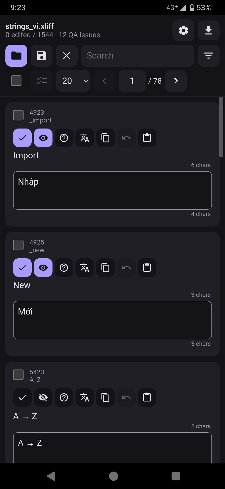
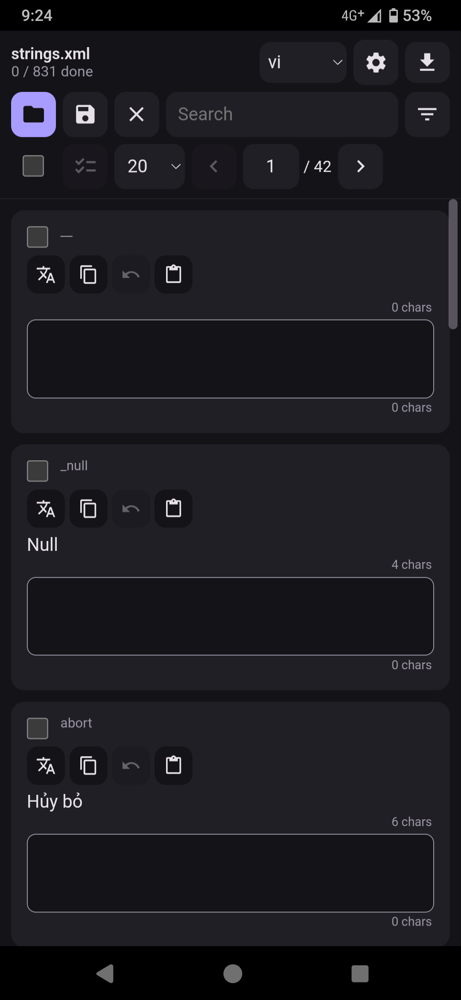
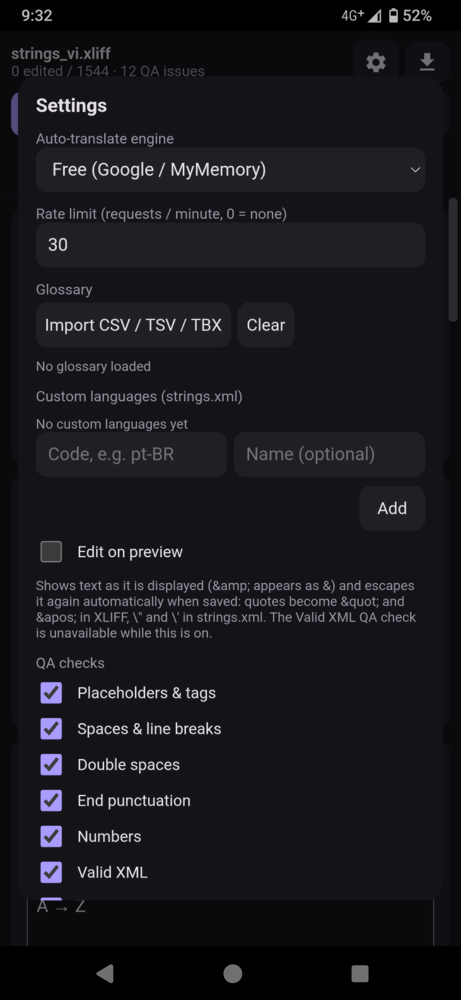

# Xliff-Editor-Android

**Translate Android apps from your phone. No computer required.**

Xliff-Editor-Android is a mobile-first localization editor for Android. It opens **XLIFF** (`.xlf` / `.xliff`) and Android **`strings.xml`** files, lets you translate them on a touchscreen, and saves the result back out, ready to share with the project owner. It is built for volunteer translators who only have a phone.

Everything runs on your device. There is no account, no server, and no upload step.

---

## Screenshots

<table>
  <tr>
    <td align="center"> XLIFF editing</td>
    <td align="center"> strings.xml editing</td>
    <td align="center"> Settings and QA checks</td>
  </tr>
</table>

---

## Features

### Open and save the formats translators actually receive
- **XLIFF 1.2 and 2.x** (`<trans-unit>` / `<unit>`), including files exported from **Crowdin** (context and labels are shown on each card).
- **Android `strings.xml`**: `<string>`, `<string-array>` and `<plurals>`. Entries marked `translatable="false"` are skipped automatically.
- For `strings.xml`, pick a target language and save as `strings-<lang>.xml`. A list of common languages is built in, and you can add your own codes (e.g. `pt-BR`, `fil`, `sr-Latn`).
- XLIFF edits are written back into the original text, so the rest of your file is left untouched.
- Save through the Android share sheet: send to Drive, email, a chat app, or a file manager.
- **Convert XLIFF to `strings.xml`** on export, with a report of anything skipped (empty, hidden, duplicate or invalid entries).

### Built for small screens
- One card per string, with live character counts and an optional per-string max length (from `maxwidth`).
- **Placeholders, escapes, entities and tags are highlighted** (`%s`, `%1$d`, `{name}`, `\n`, `&amp;`, `<b>`) so you do not break them by accident.
- Paging (10 / 20 / 50 / 100 / all) and one-tap previous/next.
- Light and dark themes that follow your system setting.

### Find things fast
- Search by ID/key, resource name, source, context, label or target text.
- Optional **regular-expression** search.
- Sort by: edited first, QA issues first, unapproved, hidden, untranslated, same as source, longest/shortest source or target, and over max length.

### Machine translation
- **Free engine:** Google Translate with a MyMemory fallback.
- **AI engines (Gemini or Groq):** use your own API key, pick from the models your key can access, and understand context: the key name, plural form, labels, max length, glossary terms, and your own notes (e.g. *"Music player app. Informal tone. Keep 'Playlist' untranslated."*).
- Placeholders and tags are protected during translation, and a warning appears if any went missing.
- Adjustable **rate limit** (requests per minute) with automatic retry on 429/503 errors.
- Translate one string, or run it on many selected strings with progress and a stop button.

### Bulk actions
Select any number of strings, then: machine translate, approve / unapprove, hide / unhide (`translate="no"`), copy source to target, or undo changes.

### Quality assurance
Each card shows warnings for:
- Missing or extra placeholders and tags
- Leading/trailing spaces and line-break differences
- Double spaces
- End-punctuation mismatches
- Number mismatches
- Invalid XML
- Glossary terms not used
- Unescaped quotes and apostrophes (`strings.xml`)
- Text over the maximum length

Every check can be turned on or off in Settings.

### Glossary
Import a **CSV, TSV or TBX** glossary. Terms are used by the QA check and passed to machine translation so key terms stay consistent.

### Import existing translations
Merge translations from another XLIFF or `strings.xml` file. A preview shows what is **new**, what would be **overwritten** and what is unchanged, so you can fill empty strings only or apply everything.

### Helpful XML error report
If a file fails to open because of broken XML, the app locates the problem lines (unescaped `&` or `<`, unclosed tags, bad attributes, invalid characters and more) and lets you save them to a `.txt` file to send back to the developer. It never modifies your file silently.

---

## Typical workflow

1. Tap the **folder** icon and open the `.xlf` or `strings.xml` file you were given.
2. For `strings.xml`, choose the target language in the top bar.
3. Translate by typing, copying the source, or using machine translation. Fix anything flagged by the QA warnings.
4. Tap **Save**, choose the format, and share the file back.

---

## Privacy

- Your files are processed **locally** on your device.
- Settings, your glossary and your Gemini / Groq API key are stored **only on your device**.
- Text is sent over the network **only** when you use machine translation: to Google Translate / MyMemory (free engine), or to the AI service you picked with your own key (Google's Gemini API or Groq). Each key is sent only to its own service.

---

## Contributing

Issues and pull requests are welcome, especially bug reports with a sample file that fails to open or save correctly. Please remove any private strings from files before attaching them.
