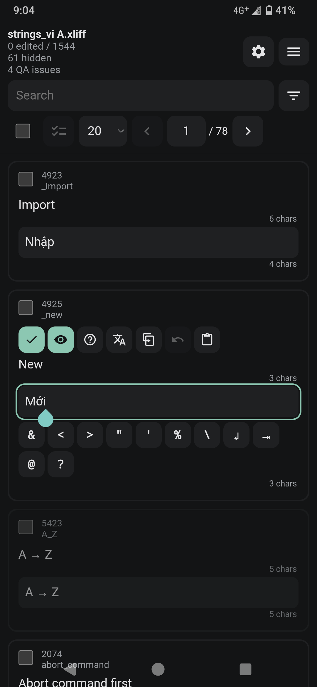
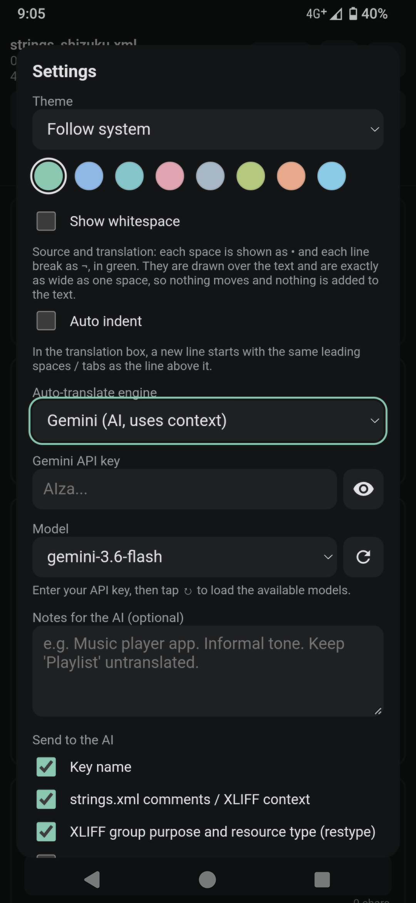

# Android Localization

A single-file HTML app, packaged with [Capacitor](https://capacitorjs.com/) for Android, for translating **Android `strings.xml`** on your phone.

It is for people who find raw XML painful to translate by hand, or who dislike the Transifex interface. Open a file, translate it unit by unit in a card-based editor, and save it back as a clean file.

  
  
  

## Features

**Formats**
- **Android `strings.xml`** is the main target. It also handles `<string-array>` and `<plurals>`.
- **XLIFF 1.2** can be opened and saved, and exported as `strings.xml`. XLIFF 2.x is not supported. Supports XLIFF 1.2 `seg-source`. Exports from Crowdin and similar tools, whose `<file original>` is `strings.xml`, `arrays.xml` or `plurals.xml`, are recognised as Android resources.

**Editing**
- One card per unit, showing the key or ID, the source text with highlighted placeholders, and the target box.
- Per-unit actions: approve, hide (`translatable="false"` / `translate="no"`), copy source, undo, comment or context, notes (XLIFF), and `formatted="false"`.
- A row of buttons under the target box inserts escaped characters (`&amp;`, `\'`, `\"`, `%%`, `\n`, `\@` and so on) at the cursor.
- A per-unit clipboard saves alternative translations so you can switch between them.
- Search by ID/key, name, source, context, note or target. Regex search is supported, and you can filter by arrays or plurals.
- Sort by edited, QA issues, unapproved, hidden, untranslated, same as source, longest or shortest text, over max length, and more.
- Pagination, multi-select and bulk actions: machine translate, approve, hide, copy source, undo, clipboard.
- The previous session (edits, approvals, clipboards) is kept on the device, and you are offered a restore on the next launch.

**Translation help**
- **Free engine**: Google Translate and MyMemory, with no key needed.
- **AI engines**: Gemini and Groq with your own API key. They can receive the key name, comments or context, notes and length limits as hints. You can also add free-text notes such as app type and tone.
- **Merged requests** for faster bulk translation, plus a configurable rate limit.
- **Glossary** import from CSV, TSV or TBX. Glossary terms are respected during translation and checked in QA.
- **Similar translations**: fuzzy matches from the strings already in the open file.
- Target language picker with a built-in list and custom language codes (for example `pt-BR`, `sr-Latn`).

**QA checks** (each can be switched off)
- Placeholders and tags, spaces and line breaks, double spaces, end punctuation, numbers.
- Valid XML, glossary terms, unescaped quotes, `\` and `%` (strings.xml), max length and storage.

**Appearance**
- Light, dark or system theme, with 8 accent colours.

## Privacy

- The app runs locally. Files are opened and saved on your device.
- API keys are stored only on the device and sent only to the matching provider (Google for Gemini, Groq for Groq).
- When you machine-translate, the source text (and the optional hints you enabled) is sent to the engine you selected. With the free engine that is Google Translate or MyMemory. Do not use machine translation on text you cannot share with those services.

## Usage

1. Tap the menu icon at the top right and choose **Open file**, then select a `strings.xml` or `.xlf` / `.xliff` file.
2. Pick the target language.
3. Translate in the cards, using machine translation, similar translations or the clipboard where useful.
4. Review QA warnings.
5. Open the menu again and choose **Save**. For an XLIFF you can also export as `strings.xml`.

Open **Settings** (gear icon) to pick a translation engine, enter an API key, import a glossary, adjust QA checks and change the theme.

## Building

The whole UI is one file, `index.html`. To build the Android app:

1. Use `index.html` as the web asset of a Capacitor Android project.
2. Run `npx cap sync android`.
3. Open the project in Android Studio (`npx cap open android`) and build as usual.

Because it is plain HTML, you can also open `index.html` in a modern browser for quick testing.

## Contributing

Issues and pull requests are welcome at <https://github.com/HoangDeXiong01/Android-Localization>.

## License

Licensed under the **GNU Affero General Public License v3.0**. See [LICENSE](LICENSE.md) for the full text.
